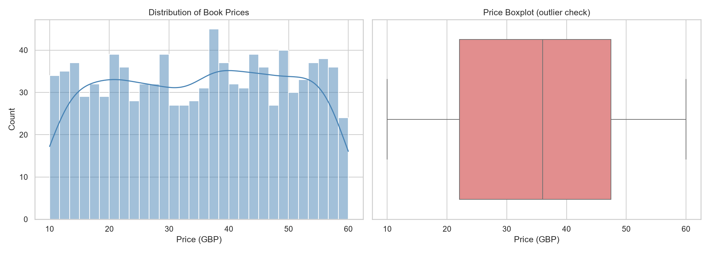
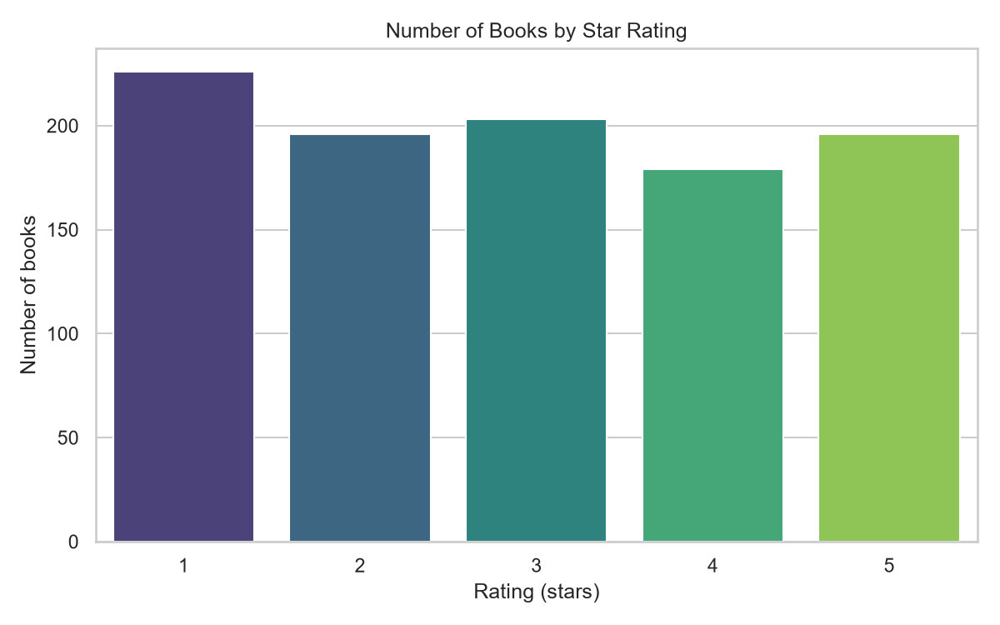
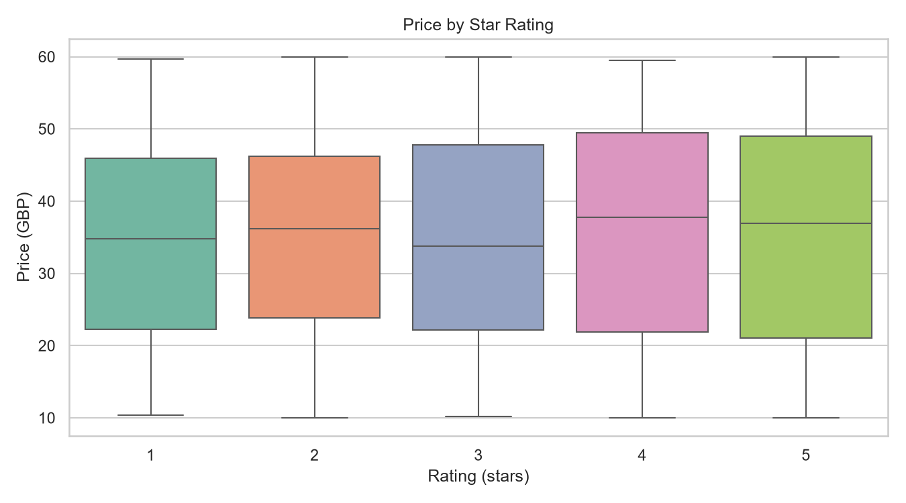
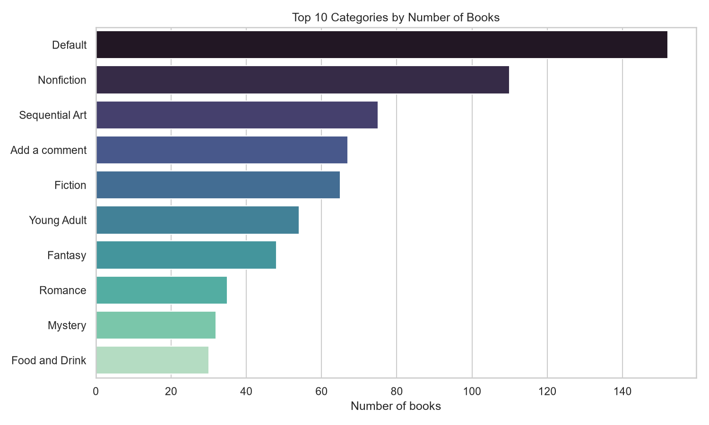
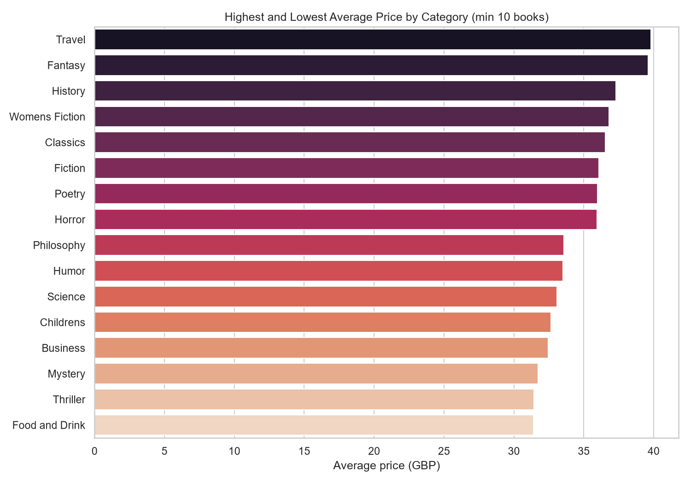

# CodeAlpha Data Analytics Internship: Books Dataset Analysis

This project covers **Task 1 (Web Scraping)**, **Task 2 (Exploratory Data Analysis)** and **Task 3 (Data Visualization)** of the CodeAlpha Data Analytics Internship.

I scraped 1,000 books from [books.toscrape.com](https://books.toscrape.com) (a practice website built for scraping), then explored the data and visualized the findings.

## Project Structure

```
CodeAlpha_ReviewAnalysis/
├── data/
│   └── books.csv                      # scraped dataset (1,000 books)
├── images/                            # charts exported from the notebook
├── notebooks/
│   └── books_eda_visualization.ipynb  # EDA and visualizations
├── scripts/
│   └── scrape.py                      # web scraping script
└── README.md
```

## Task 1: Web Scraping

`scripts/scrape.py` uses **requests** and **BeautifulSoup** to visit all 50 book categories, follow pagination, and collect:

| Column | Description |
|---|---|
| title | Book title |
| category | Book category |
| price_gbp | Price in British pounds |
| rating | Star rating (1 to 5) |
| availability | Stock status |
| url | Link to the book page |

The script waits 0.5 seconds between requests to avoid overloading the server.

## Tasks 2 & 3: EDA and Visualization

The notebook `notebooks/books_eda_visualization.ipynb` answers these questions:

1. What does the data look like, and are there quality issues?
2. How are prices distributed? Are there outliers?
3. How are ratings distributed?
4. Do higher-rated books cost more?
5. Which categories have the most books?

### Key Findings

- **Dataset:** 1,000 books, 50 categories, no missing values and no duplicate rows. One title appears twice.
- **Prices:** range from £10.00 to £59.99, with a mean of £35.07 and a median of £35.98. The IQR rule found **no outliers**.
- **Ratings:** fairly evenly spread across 1 to 5 stars (226, 196, 203, 179 and 196 books). The average rating is 2.92.
- **Price vs rating:** average price stays between £34.56 and £36.09 for every rating level, and the Spearman correlation is **0.029**, so price and rating are essentially unrelated.
- **Categories:** the largest are Default (152), Nonfiction (110) and Sequential Art (75). Among categories with at least 10 books, Poetry (3.53), Humor (3.40) and Young Adult (3.30) have the highest average ratings.
- **Data issues:** the `availability` column is "In stock" for all 1,000 books, so it carries no analytical value. The categories "Default" and "Add a comment" appear to be placeholder labels on the source site rather than real genres.

### Charts

| | |
|---|---|
|  |  |
|  |  |



## How to Run

```bash
# 1. Install dependencies
pip install requests beautifulsoup4 pandas matplotlib seaborn scipy notebook

# 2. Scrape the data (takes a few minutes)
python scripts/scrape.py

# 3. Open the notebook
cd notebooks
jupyter notebook
```

Then open `books_eda_visualization.ipynb` and choose **Run > Run All Cells**.

## Tools Used

Python, requests, BeautifulSoup, pandas, NumPy, Matplotlib, Seaborn, Jupyter Notebook, Git and GitHub.

## Author

Feros Khan | CodeAlpha Data Analytics Intern
